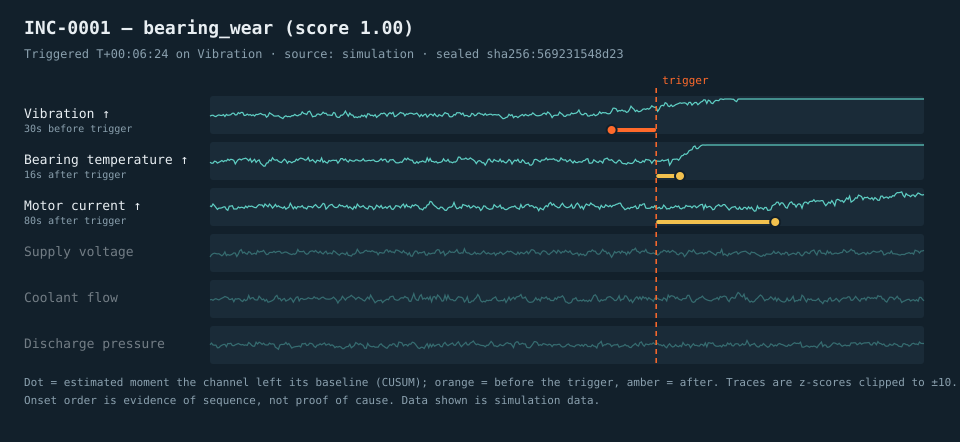

# Precursor

**A flight-data recorder for small machines: it keeps the seconds *before* something goes wrong, seals them as tamper-evident evidence, and shows which sensor moved first.**



<sub>Generated by `python -m precursor demo` from **simulated** data. Orange dot: estimated moment a channel left its normal range. The dashed line is the trigger.</sub>

> **Status: experimental prototype.** Everything below has been run on **simulated data only**. No physical hardware, real machine, or real user has been involved. See [Limitations](#limitations).

---

## Overview

**What it is.** A Python service that continuously buffers multi-channel sensor readings (current, vibration, temperature, voltage, flow, pressure in the demo). When a channel leaves its learned normal range, it freezes the last five minutes plus the next three, works out *the order in which channels started to deviate*, and stores everything in a hash-chained incident vault. A web dashboard lets you replay the incident like a flight recorder.

**The problem.** Small machines and lab rigs (pumps, fans, 3D printers, cold-storage units) usually fail in a chain: friction shows up as vibration, then heat, then extra current. By the time an alarm fires on the *last* symptom, the earliest clues have scrolled off a chart or were never stored. Threshold alarms tell you *that* something is wrong; they rarely tell you *what moved first*.

**Why it was created.** As a portfolio project that combines signal processing, a small diagnostic engine, tamper-evident storage, an API and an interactive replay UI, all runnable without hardware.

## Key features

- **Pre-trigger recording.** A ring buffer keeps up to 15 minutes of history; each incident seals 300 s before and 180 s after the trigger (configurable).
- **Robust self-calibration.** Normal range is learned from the first 240 samples using median/MAD, then adapts slowly, so no hand-tuned thresholds per sensor.
- **"Who moved first?" analysis.** A CUSUM change-point detector estimates each channel's onset time; channels are ranked into a *precursor ladder*.
- **Explainable pattern matching.** The onset order is compared with hand-written fault signatures (expected order and direction). It can answer **"unknown pattern"** instead of forcing a label.
- **Tamper-evident vault.** Each incident is sealed with `SHA-256(previous_hash + payload)`. Editing or deleting one is detected. Evidence bundles can be exported and verified offline.
- **Replay dashboard.** Live view plus a time-travel replay with scrubber, onset markers, plain-language narrative and suggested checks.
- **Simulation mode.** A built-in simulated pump rig with five fault types and a "click to inject" panel. No hardware needed.
- **Optional real input.** `POST /api/ingest` accepts readings from anything that can send JSON (an ESP32 example sketch is included, **untested on hardware**).

## Why this project is different

Most student "IoT dashboards" plot live values and fire a threshold alert. Precursor is built around a different question: *what happened in the minutes before the alarm?*

| Typical sensor dashboard | Precursor |
|---|---|
| Shows the present | Keeps and seals the **past** around an incident |
| Alert on one threshold | Persistent-excursion trigger, then **onset-order analysis** |
| Says "temperature high" | Says "vibration moved first, 30 s earlier, then temperature, then current" |
| Forces a label or nothing | Reports **unknown pattern** when nothing matches well |
| Logs can be edited silently | Hash-chained seals make edits **detectable** |

**What is established vs. what is my design.** Rolling "black box" buffers, median/MAD statistics, CUSUM (Page, 1954) and hash chains are all well-known techniques. The *proposed design* here is the combination and workflow: pre-trigger sealing + onset-order ranking + signature matching by *sequence* (no magnitudes) + an honest "unknown" outcome + offline-verifiable evidence bundles + a replay UI. The scoring formula, signatures and parameters are my own hand-written design choices, not learned or validated on real machines. I have not claimed this combination is unique in the world. Related fields include condition monitoring and AIOps root-cause analysis. See [docs/DESIGN_DECISIONS.md](docs/DESIGN_DECISIONS.md) and [docs/CONCEPT_SELECTION.md](docs/CONCEPT_SELECTION.md).

## System architecture

```
   Sensors / ESP32 / CSV file          Built-in simulator (demo)
              │                                   │
              └──────────────┬────────────────────┘
                             ▼
              POST /api/ingest        (or in-process feed)
                             │
                             ▼
   ┌──────────────────────────────────────────────────────────┐
   │ PrecursorService                                         │
   │                                                          │
   │  Recorder ── ring buffer ── persistent-excursion trigger │
   │      │            (values + live z-scores)               │
   │      ▼  incident opens; keeps recording through post-roll│
   │  Analysis ── CUSUM onsets ── signature matching          │
   │      ▼                                                   │
   │  Incident builder ── narrative ── payload                │
   └──────────────────────────────┬───────────────────────────┘
                                  ▼
                 Vault (SQLite, SHA-256 hash chain)
                                  │
                                  ▼
                 FastAPI  /api/*  +  static dashboard
                                  │
                                  ▼
       Browser: live tape · incident list · replay · verify
```

More detail, including Mermaid diagrams and the data flow: [docs/SYSTEM_ARCHITECTURE.md](docs/SYSTEM_ARCHITECTURE.md).

## How it works

1. **Learn normal.** The first 240 samples per channel give a median and a MAD-based noise estimate (the "baseline").
2. **Score every sample.** Each reading becomes a z-score: how many noise-widths it is from normal. The z-scores are stored beside the raw values.
3. **Trigger.** A channel *alarms* when |z| > 4 for 5 samples in a row. The first alarm of an episode opens an incident. Further alarms in the same episode do not open duplicates.
4. **Keep recording.** The recorder continues for the post-roll (180 s), then freezes the window: 300 s before the trigger through 180 s after.
5. **Find onsets.** A two-sided CUSUM runs over each channel's z-scores to estimate *when it started to move* and in which direction.
6. **Match patterns.** The order of onsets is compared with each signature in `config/signatures.yaml`. Score = coverage x precision x (0.6 x order + 0.4 x first-mover). Below 0.55 the verdict is `unknown_pattern`.
7. **Write it up and seal it.** A rule-based narrative is generated, the payload is hashed together with the previous incident's hash, and the bundle is stored.
8. **Explore.** The dashboard lists incidents and replays each one; `verify` re-checks the chain.

Example output from `python -m precursor demo` (simulated data, trimmed):

```
 Trigger : T+00:06:24 on Vibration (z = +4.8)
 Verdict : bearing_wear  (score 1.00, confident)

 Precursor ladder (who moved first), time relative to trigger:
  Vibration            ^ o----------------                             -30s
  Bearing temperature  ^                 --------o                     +16s
  Motor current        ^                 --------------------------o   +80s
```

## Technology stack

| Technology | Purpose here |
|---|---|
| Python 3.10+ | All logic |
| NumPy | Vectorised baseline, z-scores, simulator noise |
| CUSUM + median/MAD (hand-implemented) | Change-point onset estimation and robust normal range. No black-box ML, so every result is explainable |
| SQLite | Incident vault with hash chain (zero setup) |
| FastAPI + Uvicorn | JSON API, ingest endpoint and static hosting |
| Pydantic | Request validation |
| PyYAML | Machine, detector, fault and signature configuration |
| Vanilla JS + Canvas | Dashboard with no build step and no external requests |
| pytest, httpx | Tests (unit, integration, API) |
| Optional: ESP32 (Arduino) | Example sensor node, **untested on hardware** |

Machine learning is deliberately not used: with no real labelled failure data, a trained model would only be fitting the simulator. See [DESIGN_DECISIONS](docs/DESIGN_DECISIONS.md).

## Project structure

```
precursor/
├── README.md  LICENSE  SECURITY.md  CONTRIBUTING.md
├── .gitignore  .env.example  pyproject.toml  requirements*.txt
├── src/precursor/
│   ├── recorder.py      ring buffer, baseline, trigger, post-roll
│   ├── analysis.py      CUSUM onsets, signature scoring, verdict
│   ├── incident.py      builds the sealed payload
│   ├── narrative.py     plain-language write-up and terminal report
│   ├── vault.py         SQLite hash-chained storage and verification
│   ├── service.py       ties it together; simulator runner thread
│   ├── api.py           FastAPI app
│   ├── report.py        SVG report renderer
│   ├── evaluation.py    synthetic self-check
│   ├── cli.py           `python -m precursor ...`
│   ├── config.py        YAML + env loading and validation
│   └── simulator/       simulated pump rig (see its README)
├── app/                 dashboard (index.html, static/app.js, style.css)
├── config/              default.yaml, faults.yaml, signatures.yaml
├── docs/                architecture, user flow, decisions, tests, install, ...
├── examples/            sample CSVs, exported bundle, curl and ESP32 examples
├── scripts/             dev-only dashboard smoke test (jsdom)
└── tests/               63 pytest tests
```

The simulator lives inside the Python package (`src/precursor/simulator/`) so it can be imported by tests and the CLI, rather than in a top-level `simulator/` folder.

## Installation

Requires Python 3.10 or newer.

```bash
git clone https://github.com/<your-username>/precursor.git
cd precursor
python -m venv .venv
source .venv/bin/activate          # Windows PowerShell: .venv\Scripts\Activate.ps1
pip install -e ".[dev]"
```

Details and platform notes: [docs/INSTALLATION.md](docs/INSTALLATION.md).

## Configuration

Behaviour lives in YAML; only deployment settings and the one secret live in environment variables.

| File | What it controls |
|---|---|
| `config/default.yaml` | Channels and units, detector thresholds, pre/post-roll, server defaults |
| `config/faults.yaml` | Simulator fault effects (simulation only) |
| `config/signatures.yaml` | Expected onset order per known fault, plus suggested checks |

Environment variables (copy `.env.example` to `.env`; `.env` is git-ignored and is loaded automatically):

| Variable | Default | Meaning |
|---|---|---|
| `PRECURSOR_MODE` | `simulate` | `simulate` (built-in rig) or `ingest` (accept `POST /api/ingest`) |
| `PRECURSOR_HOST` / `PRECURSOR_PORT` | `127.0.0.1` / `8000` | Listen address |
| `PRECURSOR_SIM_SPEED` | `20` | Simulated samples per real second |
| `PRECURSOR_SIM_SEED` | `42` | Simulator random seed |
| `PRECURSOR_DB_PATH` | `data/precursor.db` | SQLite file |
| `PRECURSOR_API_KEY` | *(empty)* | If set, POST endpoints require `X-API-Key`. Never commit a real value |

## Running the project

```bash
python -m precursor serve --simulate --reset-db
# open http://127.0.0.1:8000
```

Other commands:

```bash
python -m precursor demo --fault bearing_wear        # terminal-only demo, ~1 second
python -m precursor replay examples/data/bearing_wear.csv
python -m precursor verify --file examples/sample_incident_bundle.json
python -m precursor serve --ingest                   # accept real readings via HTTP
python -m precursor --help
```

## Demo / simulation mode

No hardware is needed. `serve --simulate` runs a simulated pump rig at 20x speed.

1. Start the server and open the dashboard. It spends about 12 s learning normal; a fault is auto-injected a little later.
2. Or click a fault under **Inject a fault** (Bearing wear, Clogged intake, Brownout, Discharge blockage, Mystery heating).
3. Watch the status change to *Incident triggered*, then *sealed*. Open the incident from the right-hand list.
4. Press **Play replay** or drag the scrubber. Note the order in which channels leave normal.
5. Try **Mystery heating**: the analyser reports *Unknown pattern* because that fault is intentionally missing from the signature library.
6. Click **Verify chain**. To see tamper detection, edit a row in the SQLite file, then run `python -m precursor verify`.

## Testing

```bash
python -m pytest            # 63 tests, ~8 s
python -m precursor evaluate --runs 30   # synthetic self-check (simulation only)
```

Measured on **simulated** data (seed 1000, 30 runs per fault, this repo's own simulator and signatures, so this is an internal consistency check, not real-world accuracy):

| Injected fault | Exactly 1 incident | Correct verdict | Median trigger delay |
|---|---:|---:|---:|
| bearing_wear | 30/30 | 30/30 | 34 s |
| clogged_intake | 30/30 | 30/30 | 14 s |
| brownout | 30/30 | 30/30 | 6 s |
| discharge_blockage | 30/30 | 30/30 | 6 s |
| mystery_heating (expected: unknown) | 30/30 | 30/30 | 7 s |

Healthy runs: 10 x 6000 s, 0 false incidents. A harsher stress run (fault timing jitter +/-50%, noise x1.8) gave 149/150 correct. Full method and caveats: [docs/EVALUATION.md](docs/EVALUATION.md). Test strategy: [docs/TEST_PLAN.md](docs/TEST_PLAN.md).

## Limitations

- **Simulation only.** Nothing here has run on a real machine, real sensors or with real users. The ESP32 sketch has **not been flashed or tested**.
- **Circular evaluation.** The simulator and the signature library were written by the same author. Good scores show the pipeline is self-consistent, not that it would diagnose real faults. Detector parameters (CUSUM `k=1.5`, `h=12`, 240-sample warm-up) were tuned against simulated noise.
- **Sequence is not causation.** Onset order is evidence for an inspection, not proof of a root cause.
- **Hand-written signatures.** Only four known patterns; real machines will differ. Confidence scores are heuristic, not calibrated probabilities.
- **Slow drifts can be absorbed.** Baseline adaptation (`adapt_alpha`) can hide changes slower than about 2 sigma over hundreds of seconds.
- **Overlapping faults merge.** A second fault starting while the first episode is still latched joins the same episode instead of opening a new incident.
- **One machine per server**, roughly regular sampling assumed (parameters are per-sample), no multi-tenant support.
- **Dashboard** is checked with a headless jsdom smoke test (canvas stubbed). It has **not been visually verified in a real browser** or tested on mobile or with assistive tech.
- **Not production-ready.** No TLS, read endpoints are unauthenticated, no rate limiting. See [SECURITY.md](SECURITY.md).
- **Throughput** of ~11,000 samples/s was measured once on the development sandbox (in-memory vault); it is not a benchmark.

## Future improvements

Planned or ideas, none implemented:

- Validate against real recorded machine data (public run-to-failure datasets or a real rig) and report honest accuracy.
- Learn or tune signatures from labelled incidents; add a "closest known pattern" explanation.
- Variance and spectral triggers (vibration FFT bands), not just mean shifts.
- Publish the chain's head hash to an external anchor (git tag, transparency log) for stronger tamper evidence.
- Multi-machine support, per-device API keys, authentication for read endpoints.
- MQTT input; alert hooks (email, webhook).
- Export incidents as PDF/HTML reports.

## Security

Localhost-only by default; write endpoints can require an API key; strict CSP and `textContent`-only rendering in the dashboard; parameterised SQL; secrets only via environment. The hash chain is tamper-evident, not tamper-proof. Full list, including known gaps: [SECURITY.md](SECURITY.md).

## License

MIT. See [LICENSE](LICENSE). Replace `<YOUR NAME>` in the license file before publishing.
