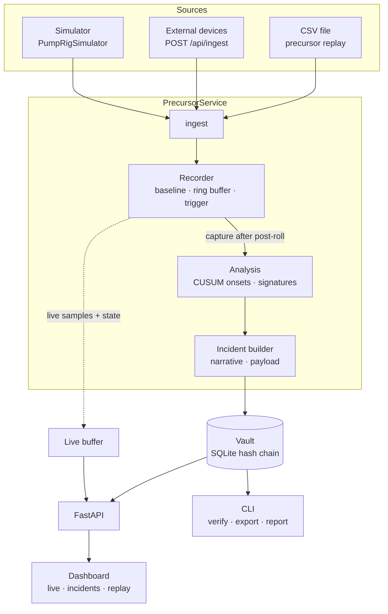
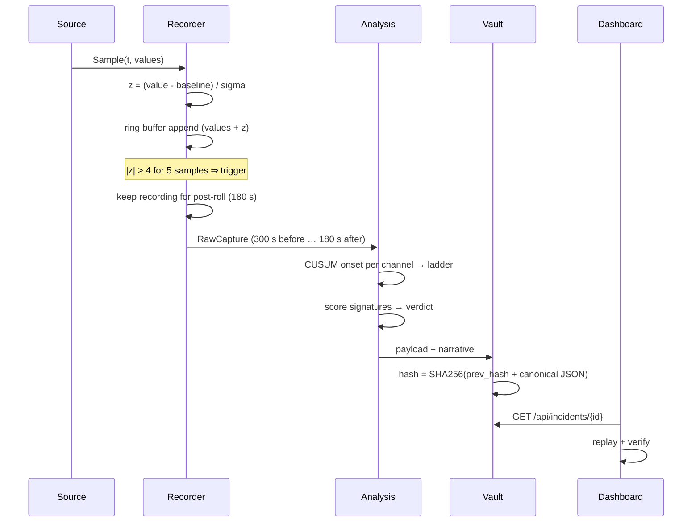

# System Architecture

Status: prototype, validated on simulated data only.

## Components

| Module | Responsibility | Depends on |
|---|---|---|
| `recorder.py` | Learn baseline, keep ring buffer, detect persistent excursions, run post-roll | config, models |
| `analysis.py` | Onset estimation (CUSUM), signature scoring, verdict | config, models |
| `incident.py` | Assemble the sealable payload | analysis, narrative |
| `narrative.py` | Human-readable write-up, terminal report | none |
| `vault.py` | Hash-chained SQLite store, verification | none |
| `service.py` | Orchestration, live buffer, simulator runner | all of the above |
| `api.py` | HTTP surface, security headers, static hosting | service, vault |
| `simulator/` | Synthetic machine (simulation only) | config |

Design rule: `recorder`, `analysis` and `vault` know nothing about HTTP or the simulator, so each can be unit-tested alone.

## Data flow

Step by step:

1. A `Sample` is `t` (seconds) plus a dict of channel values. Missing, non-finite or unknown-channel values are ignored; duplicate or out-of-order timestamps are dropped and counted.
2. During warm-up (240 samples) values are only buffered. Then median/MAD gives each channel's baseline and z-scores are back-filled.
3. After warm-up each sample gets a z-score. While a channel is calm (|z| < 2) and not latched, its baseline mean creeps toward it (`adapt_alpha`).
4. A channel alarms after `persist_samples` consecutive |z| > `z_trigger`. An incident opens on the **first alarm of an episode** (no channel currently latched).
5. A latched channel is released after `clear_samples` consecutive |z| < `z_clear`.
6. After the post-roll the window is cut from the ring buffer, gaps forward-filled, and handed to analysis.
7. The vault stores the canonical JSON and its chained hash; the API serves it.

## Incident payload (schema `precursor.incident/1`)

| Field | Content |
|---|---|
| `id`, `machine`, `trigger` | Identity, trigger time / channel / z |
| `window` | Start, end, pre/post-roll, sample count |
| `t`, `values`, `z` | Column-oriented series per channel |
| `baselines` | Mean and sigma at capture end |
| `data_quality` | Missing-reading counts per channel |
| `analysis` | `chain` (onsets), `hypotheses`, `verdict` |
| `narrative` | Rule-based text |
| `provenance` | Software version, `source` (`simulation` / `live` / `replay`), detector-config digest |
| `sealed_at_utc` | Wall-clock seal time |

A real example: [`examples/sample_incident_bundle.json`](../examples/sample_incident_bundle.json).

## API

| Method and path | Purpose | Auth |
|---|---|---|
| `GET /` | Dashboard | none |
| `GET /api/health`, `/api/config` | Status and channel / fault metadata | none |
| `GET /api/live?since=N&limit=M` | New samples since sequence N plus recorder state | none |
| `GET /api/incidents`, `/api/incidents/{id}` | List and fetch sealed incidents | none |
| `GET /api/incidents/{id}/bundle` | Download evidence bundle | none |
| `GET /api/vault/verify` | Re-check the whole chain | none |
| `POST /api/ingest` | Push readings (`ingest` mode only) | `X-API-Key` if configured |
| `POST /api/sim/inject` | Inject a simulated fault (`simulate` mode only) | `X-API-Key` if configured |

Interactive docs are served by FastAPI at `/docs` while the server runs.

## Concurrency

The simulator runs in one background thread and calls `service.ingest`. API handlers run in FastAPI's thread pool. `PrecursorService` and `Vault` each use a lock, so reads see consistent state.
