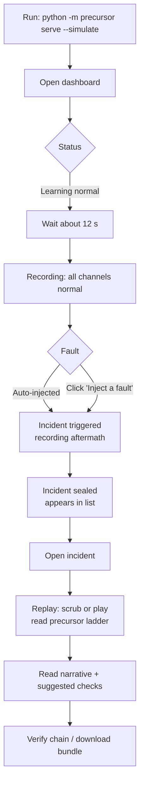
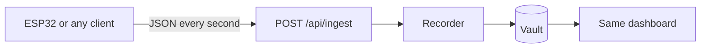

# User Flow

## Demo flow (simulation mode)



## What the viewer sees, screen by screen

1. **Live view.** Six lanes, one per channel. Each shows the current value, how far it is from normal (in noise-widths), the learned normal band, and dashed trigger lines. Traces turn amber then orange as a channel drifts. A ring-buffer bar shows how much history is held and which slice would be sealed.
2. **Status bar.** Learning normal → Recording → Incident triggered (pulsing, with post-roll progress) → Incident sealed.
3. **Incident list.** One card per sealed incident: verdict, trigger time and channel, match score.
4. **Incident replay.** Channels re-ordered so the ones that moved come first, in onset order. Orange bars run from each channel's estimated onset to the trigger. A scrubber and play button move a cursor across all channels and show each value at that instant.
5. **Conclusions panel.** Plain-language narrative, pattern-match bars, matched / not seen / also moved channels, suggested checks, and a reminder that the result is heuristic.
6. **Evidence panel.** Seal hash, previous hash, data-quality notes, bundle download, and the command to verify offline.

## Real-input flow (optional)



Start with `python -m precursor serve --ingest`, then send readings whose keys match the channel names in `config/default.yaml`. Untested on hardware.

## Offline / forensic flow

```bash
python -m precursor export INC-0001 --out inc.json
python -m precursor verify --file inc.json        # payload matches its seal?
python -m precursor verify                         # whole chain in the local DB
python -m precursor report INC-0001 --svg inc.svg  # shareable picture
```
